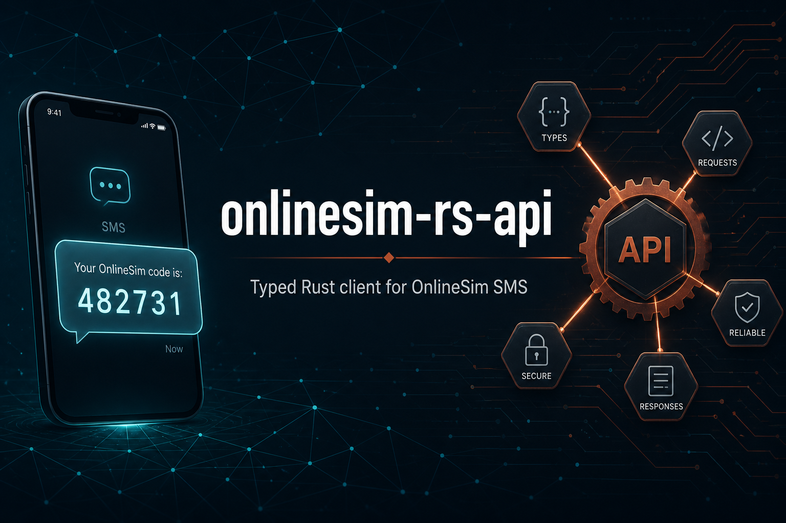

[](https://crates.io/crates/onlinesim-rs-api)
[](https://docs.rs/onlinesim-rs-api)
[](https://github.com/s00d/onlinesim-rs-api/actions/workflows/ci.yml)

<p align="center">
  
</p>

# onlinesim-rs-api

Typed Rust client for the [OnlineSim](https://onlinesim.io) API: SMS numbers, rent, account and free numbers.
Async (`reqwest` + `tokio`) and blocking clients with the same methods; Rust 1.85+.

```toml
[dependencies]
onlinesim-rs-api = "0.2"   # features = ["blocking"] for the blocking client
```

```rust
use onlinesim_rs_api::{Client, WaitCodeOptions};

#[tokio::main]
async fn main() -> onlinesim_rs_api::Result<()> {
    let client = Client::new(std::env::var("ONLINESIM_KEY").unwrap_or_default())?;
    let balance = client.user().balance().await?;
    println!("available: {} USD", balance.balance - balance.zbalance);

    let order = client.numbers().get_with_number("google", 44, &[]).await?;
    println!("enter {} in the app", order.number);
    println!("code: {}", client.numbers().wait_code(order.tzid, WaitCodeOptions::default()).await?);
    Ok(())
}
```

## Testing

`MockOnlineSim` (feature `mock-transport`, no extra dependencies) is a built-in offline fake of the API: test
your integration without network, key or money. More in the [testing guide](https://s00d.github.io/onlinesim-rs-api/testing).

```rust
use std::time::Duration;

use onlinesim_rs_api::WaitCodeOptions;
use onlinesim_rs_api::mock::{MockOnlineSim, MockOptions};

#[tokio::main]
async fn main() -> onlinesim_rs_api::Result<()> {
    let mock = MockOnlineSim::new(MockOptions { balance: 10.0, ..MockOptions::default() });
    let client = mock.client()?;

    let tzid = client.numbers().get("google", 44, &[]).await?;
    mock.add_sms_after(tzid, "Your code: 123-456", 2); // arrives on the third poll
    let options = WaitCodeOptions { interval: Duration::ZERO, ..WaitCodeOptions::default() };
    assert_eq!(client.numbers().wait_code(tzid, options).await?, "123456");
    assert_eq!(mock.balance(), 9.8);
    Ok(())
}
```

Documentation: **https://s00d.github.io/onlinesim-rs-api/** · API reference: [docs.rs](https://docs.rs/onlinesim-rs-api) · Changes: [CHANGELOG.md](CHANGELOG.md) · License: Apache-2.0
